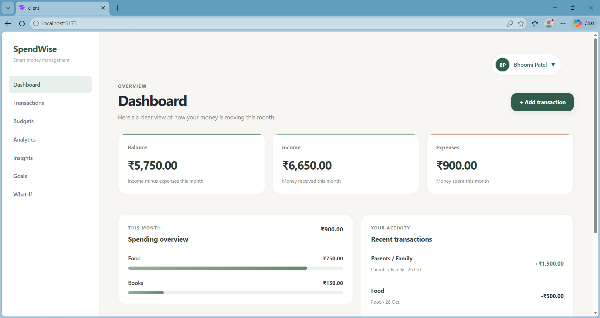
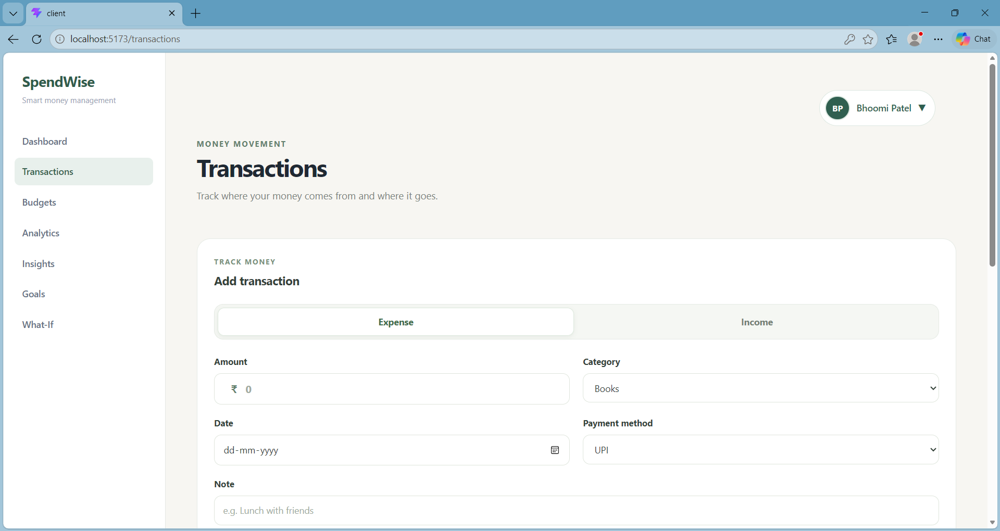
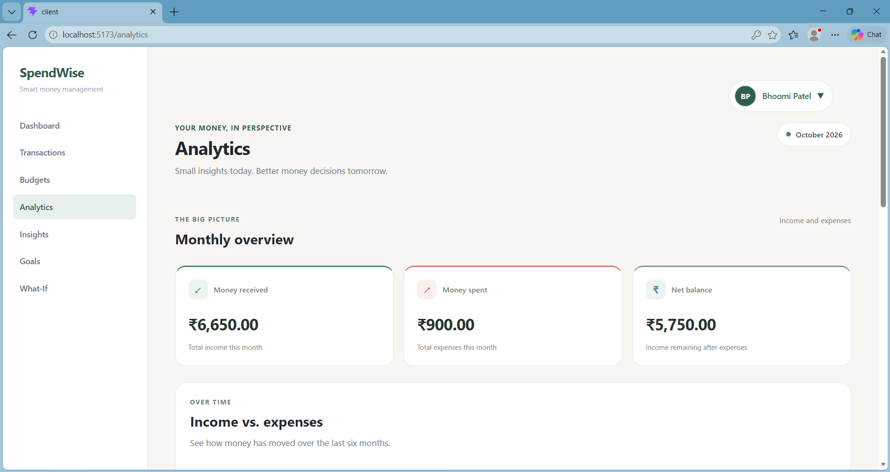
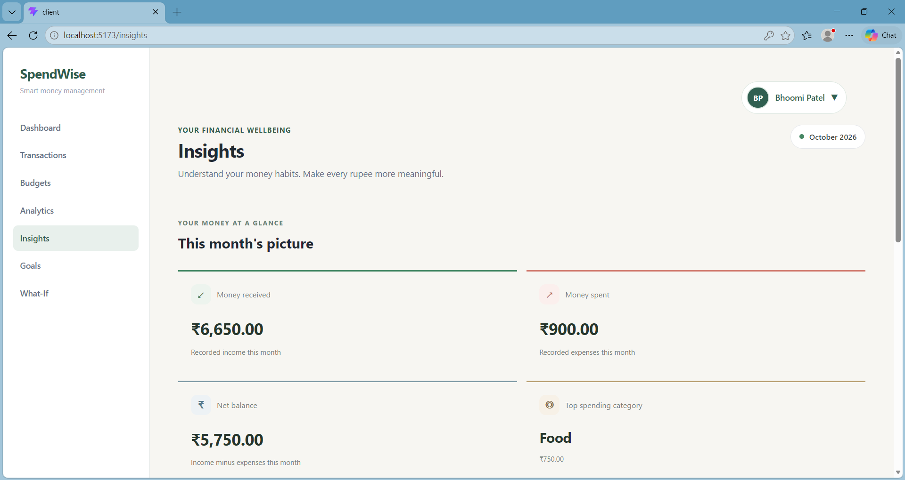
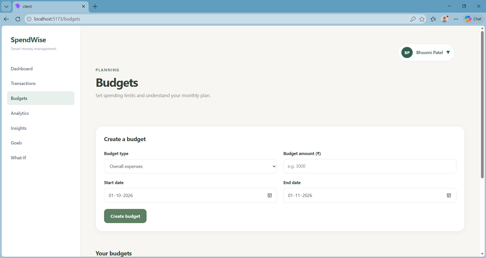
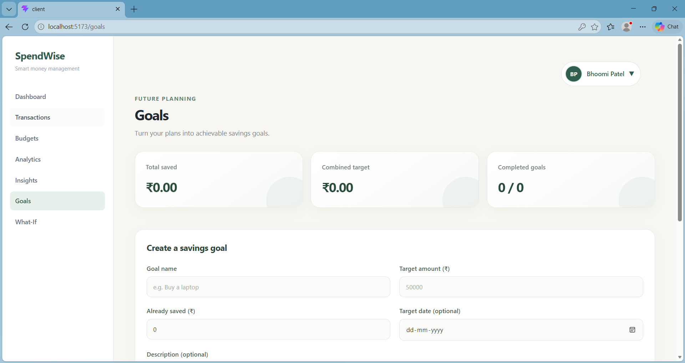
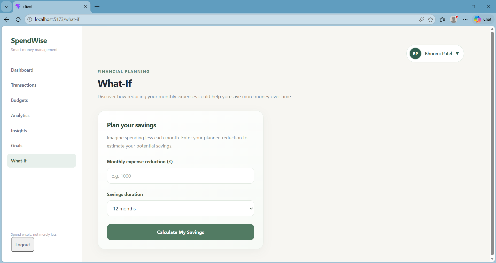

# SpendWise — Smart Student Expense Tracker

**Spend wisely, not merely less.**

SpendWise is a student-focused expense tracking application designed to help students understand, manage, and improve their financial habits. It allows users to track income and expenses, monitor budgets, set savings goals, and gain insights into their spending patterns.

## 🌐 Live Demo

**Frontend:** https://bhoomiptl.github.io/SpendWise/

**Source Code:** https://github.com/bhoomiptl/SpendWise

> **Note:** The frontend is hosted on GitHub Pages. The Express backend and MongoDB integration are available for local execution but are not publicly deployed. Authentication and database-dependent features therefore require local setup.

## ✨ Features

* **User Authentication:** Secure registration and login.
* **Dashboard:** Overview of income, expenses, balance, and financial activity.
* **Transaction Management:** Add, edit, delete, and manage income and expenses.
* **Search and Filters:** Find transactions using notes, categories, transaction types, and payment methods.
* **Analytics:** Visualize spending patterns and category-wise expenses.
* **Budget Management:** Set budgets and monitor spending.
* **Savings Goals:** Create and track personal savings goals.
* **Spending Insights:** Understand financial habits through spending insights.
* **What-If Analysis:** Explore hypothetical savings scenarios.

## 🛠️ Tech Stack

### Frontend

* React.js
* JavaScript
* Vite
* HTML5
* CSS3

### Backend

* Node.js
* Express.js

### Database

* MongoDB
* Mongoose

### Authentication & Security

* JSON Web Tokens (JWT)
* HTTP-only Cookies
* bcryptjs

### Tools

* Git
* GitHub
* npm

## 🖥️ Application Screenshots

### Dashboard



### Transactions



### Analytics



### Insights



### Budgets



### Savings Goals



### What-If Analysis



## ⚙️ Run Locally

Follow these steps to run SpendWise on your local machine.

### 1. Clone the Repository

```bash
git clone https://github.com/bhoomiptl/SpendWise.git
cd SpendWise
```

### 2. Set Up the Backend

```bash
cd server
npm install
```

Create a `.env` file inside the `server` folder:

```env
PORT=5000
MONGO_URI=your_mongodb_connection_string
JWT_SECRET=your_jwt_secret
```

Start the backend:

```bash
npm run dev
```

The backend will run at:

`http://localhost:5000`

### 3. Set Up the Frontend

Open another terminal:

```bash
cd client
npm install
```

Create a `.env` file inside the `client` folder if required:

```env
VITE_API_BASE_URL=http://localhost:5000/api
```

Start the frontend:

```bash
npm run dev
```

The frontend will run at:

`http://localhost:5173`

## 📁 Project Structure

```text
SpendWise/
│
├── client/                 # React frontend
│
├── server/                 # Express backend
│   └── src/
│       ├── config/
│       ├── controllers/
│       ├── middleware/
│       ├── models/
│       ├── routes/
│       └── server.js
│
├── docs/                   # Project documentation
│
├── screenshots/            # Application screenshots
│
├── .github/                # GitHub Actions workflow
│
├── .gitignore
└── README.md
```

## 🎯 Project Vision

SpendWise aims to encourage financial awareness among students by helping them understand not only how much they spend, but also where and why they spend it.

The goal is to make money management more intentional, practical, and accessible for students.

## 🚀 Future Improvements

* UPI transaction integration
* Recurring transaction support
* Exportable financial reports
* Enhanced personalized financial insights
* Mobile-friendly experience improvements

## 👩‍💻 Developer

**Bhoomi Patel**

B.Tech Computer Science and Engineering (Artificial Intelligence)

GitHub: [@bhoomiptl](https://github.com/bhoomiptl)

---

**SpendWise — Spend wisely, not merely less.**
